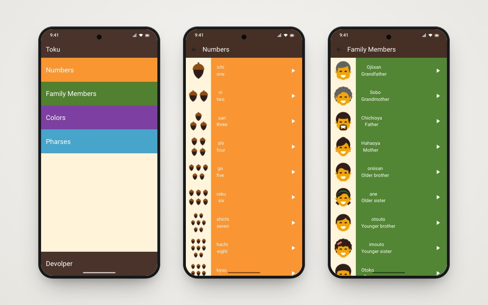

<h1 align="center">Toku</h1>

<p align="center">Learn basic Japanese vocabulary by tapping and listening, with native audio for every word.</p>

<p align="center">
  
  
  
</p>

<p align="center">
  
  <br/><sub>Home · Numbers · Family members</sub>
</p>

## 📖 About

Toku is a small Japanese-vocabulary app I built while learning Flutter. Words are grouped into four categories. Each entry shows the Japanese reading, the English meaning and a picture, and tapping play speaks the word. The project practises widget composition, reusable components, data models, `Navigator` routing and audio playback with `audioplayers`.

## ✨ Features

- 🔢 **Numbers**: one to ten (*ichi, ni, san…*) with illustrations.
- 👨‍👩‍👧 **Family Members**: father, mother, grandparents, siblings and more.
- 🎨 **Colors**: the basic colors with swatches.
- 💬 **Phrases**: everyday sentences.
- 🔊 **Audio pronunciation**: every item plays its own bundled MP3 through `audioplayers`.
- 👤 **Developer page**: a short profile with the languages I work with.

## 🛠 Tech stack

- **Flutter / Dart** (SDK `>=3.4.3 <4.0.0`)
- **audioplayers**: plays the bundled pronunciation clips
- Stateless widgets, a shared `ItemsModel`, and reusable list-item components

## 🏗 Project structure

```
lib/
├── components/   # category tile and word-row widgets
├── models/       # ItemsModel (image, Japanese name, English name, sound)
├── screens/      # home, numbers, family, colors, phrases, developer
└── main.dart
assets/
├── images/       # numbers, family_members, colors, developer
└── sounds/       # numbers, family_members, colors, phrases
```

## 🚀 Getting started

```bash
git clone https://github.com/youssef336/toke_app.git
cd toke_app
flutter pub get
flutter run
```

No API keys or backend required.

## 👤 Author

**Youssef Belal Zakaria** · [GitHub @youssef336](https://github.com/youssef336)

⭐ If you like this project, give it a star!
